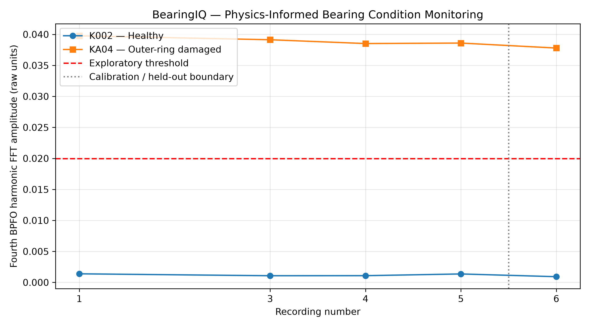

# BearingIQ — Physics-Informed Bearing Condition Monitoring

**Mechanical Engineering | Vibration Analysis | Python | FFT | Condition Monitoring**

## Project Overview

BearingIQ is a Python-based engineering analytics project that investigates rolling-element bearing condition using real vibration measurements and bearing fault-frequency calculations.

The project combines mechanical engineering fundamentals, signal processing, numerical analysis, data-quality validation, and an exploratory diagnostic decision rule to distinguish selected healthy and outer-ring-damaged bearing recordings.

The central engineering question is:

**Can a physically derived bearing fault-frequency signature provide a more informative indication of outer-ring damage than general vibration statistics alone?**

## Engineering Problem

Rolling-element bearings are critical components in rotating machinery. Localized defects can generate repetitive mechanical impacts as rolling elements pass over damaged surfaces.

These impacts may produce characteristic vibration frequencies related to bearing geometry and shaft rotational speed.

General vibration indicators, such as RMS and peak amplitude, do not always provide a clear distinction between healthy and damaged bearings.

BearingIQ therefore investigates whether frequency-domain features derived from bearing kinematics can support condition assessment.

## Dataset

**Source:** Paderborn University Bearing Data Center

**Reference:** Lessmeier et al. (2016), *Condition Monitoring of Bearing Damage in Electromechanical Drive Systems by Using Motor Current Signals of Electric Motors: A Benchmark Data Set for Data-Driven Classification.*

Selected bearings:

| Bearing | Condition |
|---|---|
| K002 | Healthy reference |
| KA04 | Real outer-ring fatigue damage |

Selected operating condition:

- Shaft speed: 900 rpm
- Load torque: 0.7 Nm
- Radial force: 1,000 N
- Nominal vibration sampling frequency: 64 kHz
- Measurement duration: approximately 4 seconds

The original MATLAB recordings are loaded using SciPy.

Raw dataset files are excluded from this repository and must be obtained separately from the original dataset provider.

## Engineering Methodology

### 1. Measurement Inspection and Data Quality

The project examines vibration sample counts, recording durations, timestamp monotonicity, sampling-interval deviations and measurement consistency.

Some recordings contain slightly different sample counts despite approximately four-second durations. The analysis uses the documented nominal sampling frequency of 64 kHz and records this as a limitation.

### 2. Time-Domain Vibration Analysis

The following features are calculated:

- Mean
- Root Mean Square (RMS)
- Absolute peak amplitude
- Crest factor

These features provide general information about vibration magnitude and impulsiveness.

However, they are not necessarily specific to a particular bearing failure mechanism.

### 3. Bearing Fault-Frequency Calculation

The Ball Pass Frequency of the Outer Race (BPFO) is estimated from bearing geometry and shaft speed:

\[
BPFO = \frac{Z}{2} f_r \left(1-\frac{d}{D}\cos\theta\right)
\]

Where:

- \(Z\): number of rolling elements
- \(f_r\): shaft rotational frequency
- \(d\): rolling-element diameter
- \(D\): pitch diameter
- \(\theta\): contact angle

For the selected damaged-bearing geometry and operating speed, the theoretical BPFO is approximately **45.81 Hz**.

### 4. Frequency-Domain Analysis

The vibration signals are processed using:

- Mean removal
- Hann windowing
- Real-valued Fast Fourier Transform (FFT)
- One-sided amplitude-spectrum calculation

The measured damaged-bearing spectrum contains peaks close to multiple harmonics of the theoretical BPFO.

### 5. Physics-Informed Diagnostic Feature

The fourth BPFO harmonic, approximately **183.24 Hz**, was selected as an exploratory diagnostic feature because it exhibited strong separation in the initial comparison.

The maximum FFT amplitude within ±2 Hz of the target frequency is extracted.

### 6. Repeatability and Held-Out Evaluation

Recordings 1, 3, 4 and 5 were used for exploratory threshold selection.

Recording 6 from each bearing was reserved for a held-out evaluation.

Recording 2 was excluded pending further investigation of sample-count and timestamp behavior.

The decision threshold was selected midway between the maximum healthy and minimum damaged feature amplitudes in the calibration recordings.

This threshold is an exploratory, data-derived boundary rather than a validated industrial alarm limit.

## Results

### BPFO Harmonic Verification

The measured spectral peaks in the damaged bearing closely matched the theoretical BPFO harmonics.

For example:

| Harmonic | Predicted frequency | Measured frequency |
|---|---:|---:|
| 1× | 45.81 Hz | 46.00 Hz |
| 2× | 91.62 Hz | 91.75 Hz |
| 3× | 137.43 Hz | 137.50 Hz |
| 4× | 183.24 Hz | 183.50 Hz |

### Repeatability

At the fourth BPFO harmonic:

| Metric | K002 healthy | KA04 damaged |
|---|---:|---:|
| Mean FFT amplitude | 0.001227 | 0.039004 |
| Standard deviation | 0.000171 | 0.000577 |
| Coefficient of variation | 13.89% | 1.48% |

The damaged bearing's mean fourth-harmonic amplitude was approximately **31.8 times higher** than the healthy reference across the four calibration recordings.

### Held-Out Evaluation

The fixed exploratory threshold was 0.019952 in raw recorded amplitude units.

| Bearing | Held-out amplitude | Decision |
|---|---:|---|
| K002 | 0.000921 | Normal |
| KA04 | 0.037792 | Inspect |

Both held-out recordings produced the expected decisions without adjusting the threshold.

### Diagnostic Visualization



The figure shows the separation between healthy and damaged recordings, the exploratory threshold, and the held-out evaluation boundary.

## Engineering Interpretation

The results demonstrate that a vibration feature tied to the expected outer-ring fault frequency can provide stronger separation for the selected recordings than overall RMS alone.

The observed harmonic structure is physically consistent with repetitive impacts caused by a localized outer-ring defect.

This supports a physics-informed approach to vibration-based condition monitoring.

## Limitations

- Only two physical bearings were used in the primary comparison.
- The analysis considers one nominal operating condition.
- The diagnostic threshold was selected using the available calibration recordings and is not an industrial alarm threshold.
- Held-out recordings originate from the same physical bearings, so the evaluation does not establish generalization to unseen bearings.
- Some recordings show sample-count differences and timestamp irregularities.
- FFT amplitudes are reported in raw recorded units because the measurement calibration has not been independently verified.
- Bearing-specific geometry and other physical differences may influence the observed separation.

## Tools and Technologies

- Python
- NumPy
- SciPy
- Matplotlib
- Git and GitHub
- Visual Studio Code
- MATLAB-format engineering measurement data

## Installation

Clone the repository and create a Python virtual environment.

Install the dependencies:

```bash
python -m pip install -r requirements.txt
```

Download the required Paderborn bearing recordings separately and place them under:

```text
data/raw/K002/
data/raw/KA04/
```

Run the analysis scripts:

```bash
python compare_fft.py
python repeatability_fft.py
python validate_threshold.py
python plot_diagnostic_results.py
```

The diagnostic figure is saved in:

```text
results/figures/
```

## Future Improvements

- Automate feature-table generation directly from the source recordings.
- Investigate acquisition timestamp irregularities in greater detail.
- Expand validation to additional healthy and damaged physical bearings.
- Evaluate multiple operating speeds and loads.
- Investigate envelope analysis and additional fault-frequency features.
- Develop a threshold calibrated using healthy reference measurements and evaluated on independent bearing-level test cases.

## Engineering Conclusion

BearingIQ demonstrates a reproducible introductory workflow for vibration-based bearing condition assessment, connecting bearing kinematics, measured vibration signals, Python signal processing, exploratory feature extraction, and engineering decision-making.

The project illustrates how mechanical engineering knowledge can guide data analysis and produce physically interpretable condition-monitoring features.
