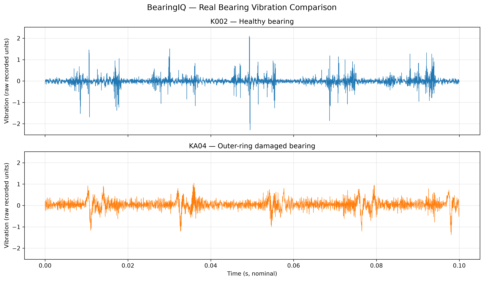
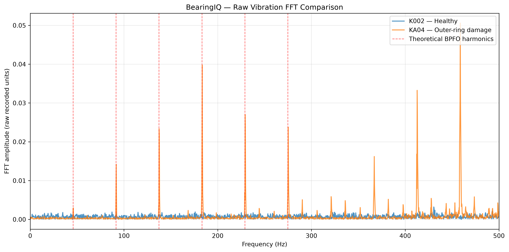
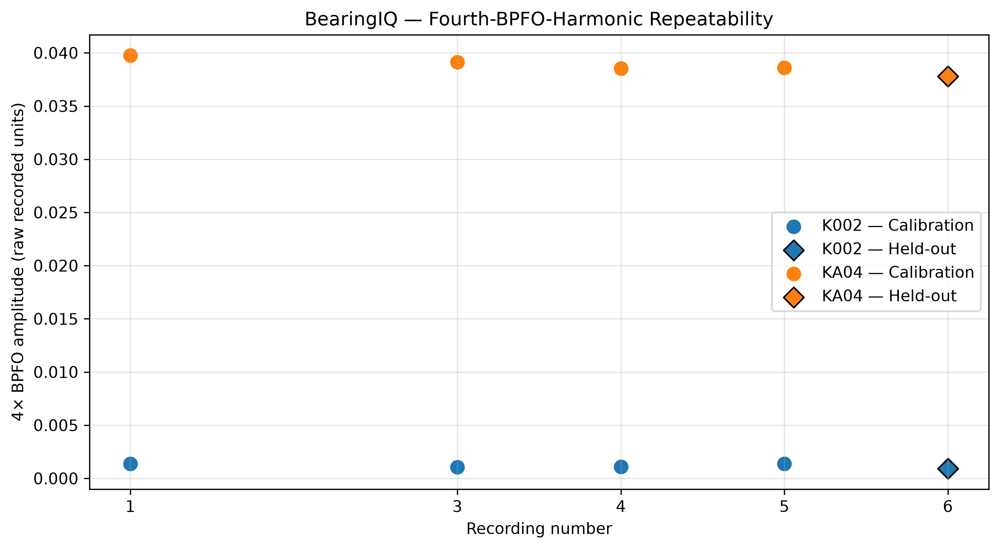

# BearingIQ — Bearing Vibration Analysis and Condition Monitoring

**Python | Mechanical Engineering | Vibration Analysis | FFT | Bearing Fault Diagnosis**

## About the Project

BearingIQ is a Python project I developed to analyze vibration measurements from healthy and damaged rolling-element bearings.

I used the Paderborn University bearing dataset to investigate how bearing damage affects vibration signals and whether characteristic bearing fault frequencies can help identify outer-ring damage.

The main focus was to understand the mechanical behavior behind the vibration signals, apply signal-processing techniques, and compare the results with theoretical bearing fault frequencies.

I also developed a simple diagnostic method based on the FFT amplitude near the fourth harmonic of the outer-ring fault frequency.

## 1. Problem and Approach

Bearings are widely used in motors, gearboxes and other rotating machinery. When a bearing develops localized damage, contact between the rolling elements and the damaged surface can produce repeated vibration impulses.

These impulses may appear as characteristic frequencies in the vibration spectrum.

I started by comparing basic vibration measurements such as RMS, peak amplitude and crest factor. However, the healthy bearing did not always have lower overall vibration levels than the damaged bearing.

This showed why general vibration magnitude alone may not be enough to identify a specific bearing fault.

I therefore calculated the theoretical outer-ring fault frequency and checked whether the measured vibration spectrum contained corresponding frequency components.

## 2. Dataset and Operating Conditions

I used real bearing vibration measurements from the **Paderborn University Bearing Data Center**.

The main comparison uses two bearings:

| Bearing ID | Condition |
|---|---|
| K002 | Healthy bearing |
| KA04 | Bearing with real outer-ring fatigue damage |

I also inspected K001 as an additional healthy reference during the initial analysis.

All measurements used for the main comparison were taken under the same nominal operating condition.

| Parameter | Value |
|---|---|
| Shaft speed | 900 rpm |
| Load torque | 0.7 Nm |
| Radial force | 1,000 N |
| Nominal sampling frequency | 64 kHz |
| Recording duration | Approximately 4 seconds |

The dataset is provided in MATLAB `.mat` format. I used SciPy to extract the vibration channel and its associated timestamps.

The original measurement files are not included in this repository.

**Dataset reference:** Lessmeier et al. (2016), *Condition Monitoring of Bearing Damage in Electromechanical Drive Systems by Using Motor Current Signals of Electric Motors: A Benchmark Data Set for Data-Driven Classification.*

## 3. Vibration Data Inspection

Before performing the FFT analysis, I inspected the measurement files to understand their structure and check the recorded data.

This included checking:

- Available measurement channels and vibration samples
- Number of samples and recording duration
- Timestamp intervals and sampling consistency
- Mean, RMS, absolute peak amplitude and crest factor

Some recordings had slightly different sample counts despite having approximately four-second durations. I also found a small number of unusual timestamp intervals.

For the FFT calculations, I used the dataset's documented nominal sampling frequency of 64 kHz. The timestamp differences remain a limitation of the current analysis.

## 4. Time-Domain Vibration Comparison

I first plotted the vibration signals from K002 and KA04 over a 0.1-second interval.



The healthy bearing showed several large instantaneous vibration peaks. The damaged bearing had a different vibration pattern, but its largest peaks were not necessarily higher.

This was an important observation because a high peak amplitude does not automatically indicate a damaged bearing.

The time-domain signals were useful for examining the measured vibration behavior, but they did not clearly identify the type of bearing fault.

## 5. Bearing Fault-Frequency Calculation

To connect the vibration analysis with bearing mechanics, I calculated the theoretical Ball Pass Frequency of the Outer Race (BPFO).

The BPFO describes how frequently rolling elements pass a fixed location on the outer race, based on the bearing geometry and shaft speed.

The equation is:

\[
BPFO = \frac{Z}{2} f_r \left(1-\frac{d}{D}\cos\theta\right)
\]

Where:

- \(Z\) = number of rolling elements
- \(f_r\) = shaft rotational frequency
- \(d\) = rolling-element diameter
- \(D\) = pitch diameter
- \(\theta\) = contact angle

For the selected bearing geometry, I used:

| Parameter | Value |
|---|---|
| Number of rolling elements | 8 |
| Ball diameter | 6.75 mm |
| Pitch diameter | 28.55 mm |
| Contact angle | 0° |
| Shaft rotational frequency | 15 Hz |

The calculated BPFO was approximately **45.81 Hz**.

I then used this frequency to identify the expected locations of its harmonics in the vibration spectrum.

## 6. FFT Analysis

I used NumPy to calculate the Fast Fourier Transform of the vibration measurements.

Before calculating the FFT, I removed the mean value and applied a Hann window to reduce spectral leakage. I then calculated the one-sided amplitude spectrum with window-amplitude correction.

I compared the healthy and damaged bearing spectra over the frequency range from 0 to 500 Hz.



The damaged bearing showed several clear peaks close to the theoretical BPFO harmonics.

| BPFO harmonic | Theoretical frequency | Measured frequency (KA04) |
|---|---:|---:|
| 1× | 45.81 Hz | 46.00 Hz |
| 2× | 91.62 Hz | 91.75 Hz |
| 3× | 137.43 Hz | 137.50 Hz |
| 4× | 183.24 Hz | 183.50 Hz |
| 5× | 229.05 Hz | 229.25 Hz |
| 6× | 274.86 Hz | 275.25 Hz |

The measured frequencies were close to the predicted values.

The healthy bearing generally had much lower amplitudes around these frequencies.

This provided a more specific indication of outer-ring damage than comparing overall vibration magnitude alone.

## 7. Diagnostic Feature Selection

After comparing the BPFO harmonics, I selected the fourth harmonic as the main diagnostic feature.

Its theoretical frequency is approximately **183.24 Hz**.

For each recording, I extracted the maximum FFT amplitude within ±2 Hz of this frequency.

The fourth harmonic was selected because it showed strong separation between the two bearings in the initial analysis. It was an exploratory choice based on the available measurements, not a feature validated across a larger bearing population.

For recording 1, the extracted amplitudes were:

| Bearing | Fourth-BPFO-harmonic amplitude |
|---|---:|
| K002 — Healthy | 0.001386 |
| KA04 — Damaged | 0.039767 |

The damaged bearing had approximately 28.7 times the amplitude of the healthy bearing for this recording.

## 8. Repeatability Analysis

I wanted to check whether the difference was consistent across multiple recordings rather than relying on a single measurement.

I used recordings 1, 3, 4 and 5 from each bearing for the calibration analysis.

For each recording, I calculated the fourth-BPFO-harmonic amplitude. I then calculated the mean, sample standard deviation and coefficient of variation.



The results were:

| Metric | K002 — Healthy | KA04 — Damaged |
|---|---:|---:|
| Mean amplitude | 0.001227 | 0.039004 |
| Sample standard deviation | 0.000171 | 0.000577 |
| Coefficient of variation | 13.89% | 1.48% |

Across these four recordings, the damaged bearing had approximately **31.8 times higher mean fourth-harmonic amplitude** than the healthy bearing.

The damaged bearing also had a lower coefficient of variation, indicating that this feature was relatively consistent across its selected recordings.

This comparison describes repeatability for these two physical bearings under one operating condition.

## 9. Diagnostic Threshold and Held-Out Evaluation

I developed a simple decision rule using the fourth-BPFO-harmonic amplitude.

The threshold was calculated as the midpoint between the highest healthy amplitude and the lowest damaged amplitude in the calibration recordings.

The calculated exploratory threshold was approximately:

**0.019953 — raw recorded amplitude units**

The decision rule was:

- Amplitude above the threshold: **Inspect**
- Amplitude at or below the threshold: **Normal**

I kept recording 6 from each bearing separate from threshold selection and used it for a held-out evaluation.


The held-out results were:

| Bearing | Fourth-harmonic amplitude | Expected condition | Decision |
|---|---:|---|---|
| K002 | 0.000921 | Normal | Normal |
| KA04 | 0.037792 | Inspect | Inspect |

Both recordings produced the expected decisions without changing the threshold.

However, these measurements came from the same physical bearings used during calibration. This means the test checks the decision rule on additional recordings, not on previously unseen bearings.

## 10. Python Implementation

I organized the project into reusable functions, analysis scripts and separate learning exercises.

The main Python workflow covers:

1. Loading MATLAB vibration measurements using SciPy
2. Inspecting signal and timestamp quality
3. Calculating time-domain vibration features
4. Calculating theoretical bearing fault frequencies
5. Performing FFT analysis using NumPy
6. Extracting BPFO harmonic amplitudes
7. Evaluating repeatability and calculating the threshold
8. Testing held-out recordings
9. Exporting results to CSV and generating figures using Matplotlib

The main analysis scripts are located in `scripts/`, while shared functions are stored in `src/bearing_utils.py`.

The `experiments/` folder contains smaller exercises I used while learning vibration analysis, RMS, FFT, signal-to-noise ratio and statistical repeatability.

## 11. Tools Used

| Tool | How I used it |
|---|---|
| Python | Developed the vibration-analysis and condition-monitoring workflow |
| NumPy | Signal calculations, RMS, statistics and FFT processing |
| SciPy | Loaded the MATLAB bearing measurement files |
| Pandas | Read and processed the diagnostic feature table for visualization |
| Matplotlib | Created time-domain, FFT, repeatability and diagnostic plots |
| VS Code | Developed and tested the Python scripts |
| Git and GitHub | Version control, project organization and documentation |

## 12. Project Structure

```text
BearingIQ/
├── src/
│   └── bearing_utils.py
├── scripts/
│   ├── bearing_fault_frequency.py
│   ├── compare_bearings.py
│   ├── compare_fft.py
│   ├── inspect_bearing_data.py
│   ├── repeatability_fft.py
│   ├── validate_threshold.py
│   ├── plot_real_vibration.py
│   ├── plot_repeatability.py
│   └── plot_diagnostic_results.py
├── experiments/
├── data/
│   └── raw/
├── results/
│   ├── diagnostic_features.csv
│   ├── calibration_threshold.txt
│   └── figures/
├── requirements.txt
├── .gitignore
└── README.md
```

The raw measurement files and Python virtual environment are excluded from Git.

## 13. Running the Project

Clone the repository:

```bash
git clone https://github.com/Chethankumardk/BearingIQ.git
cd BearingIQ
```

Create and activate a virtual environment.

For Windows PowerShell:

```powershell
python -m venv .venv
.\.venv\Scripts\Activate.ps1
```

Install the dependencies:

```bash
python -m pip install -r requirements.txt
```

Download the Paderborn bearing dataset separately and place the required recordings in the corresponding bearing folders under `data/raw/`.

For the main comparison, the project uses recordings from K002 and KA04 under the operating condition `N09_M07_F10`. Some inspection scripts also use K001.

Run the analysis from the project root in the following order:

```bash
python -m scripts.compare_bearings
python -m scripts.compare_fft
python -m scripts.repeatability_fft
python -m scripts.validate_threshold
python -m scripts.plot_real_vibration
python -m scripts.plot_repeatability
python -m scripts.plot_diagnostic_results
```

The repeatability script generates the diagnostic feature CSV and saves the calibration threshold. The plotting scripts save the figures in `results/figures/`.

## 14. Limitations and Next Steps

This is an initial condition-monitoring study using a limited number of measurements.

The main limitations are:

- The primary comparison uses only two physical bearings.
- All main recordings were taken at one nominal operating condition.
- The fourth BPFO harmonic was selected after examining the initial measurements.
- The threshold was calculated using both healthy and damaged calibration recordings.
- The held-out evaluation does not demonstrate performance on independent bearings.
- Some measurement files have sample-count or timestamp irregularities that need further investigation.
- The vibration amplitudes are reported in raw recorded units because the complete measurement calibration has not been independently verified.

The next improvements would be to test additional physical bearings, evaluate different operating conditions, investigate envelope analysis and assess how well the diagnostic features work on independent measurements.

## 15. What I Learned

This project helped me connect mechanical engineering calculations with real vibration data.

The main lesson was that vibration magnitude alone does not always explain bearing condition. The healthy bearing could show larger instantaneous peaks, while the damaged bearing had stronger frequency components near the expected outer-ring fault harmonics.

By calculating the theoretical BPFO first and then checking the measured spectrum, I could interpret the FFT results using the bearing's mechanical behavior rather than relying only on general signal statistics.

I also gained practical experience with MATLAB measurement files, Python signal processing, data-quality checks, repeatability analysis, Git and technical documentation.

The result is a working introductory bearing condition-monitoring workflow that I can extend and test with more independent measurements.
